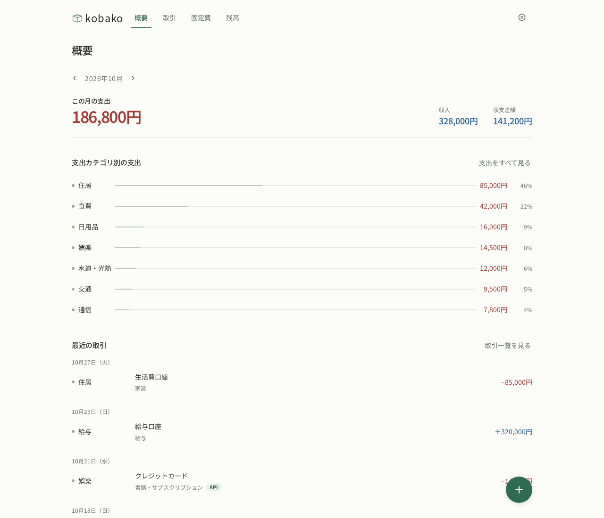
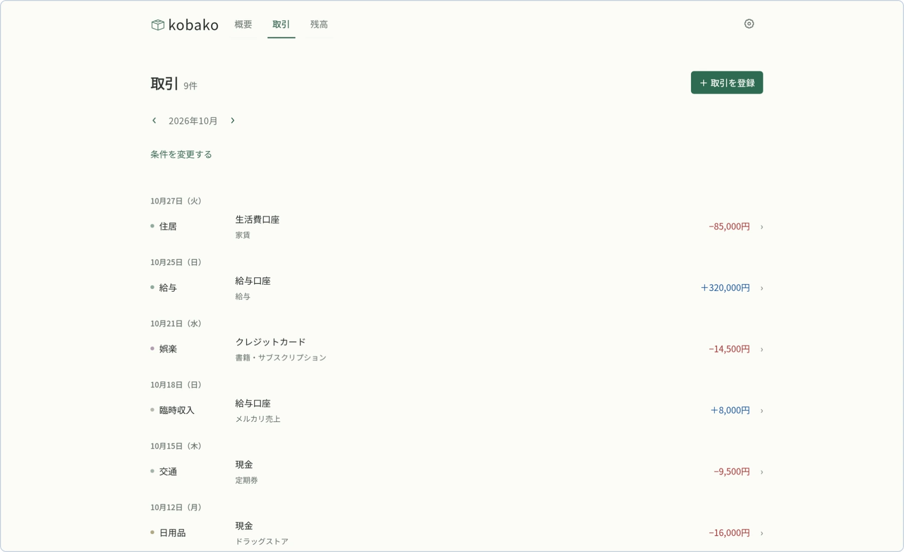
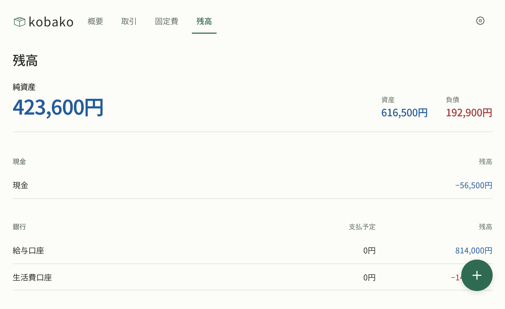
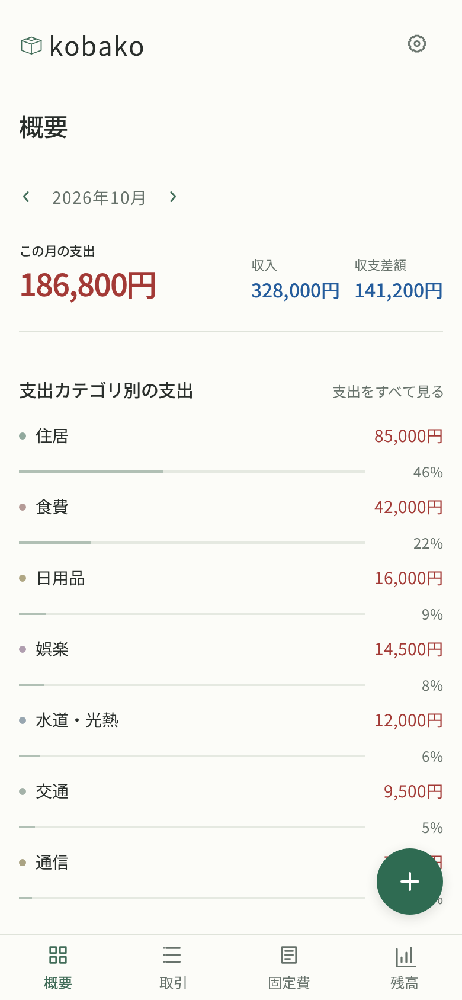

<h1 align="center">kobako</h1>

<p align="center">
  暮らしのお金を、ひと目で。<br>
  自分のサーバーで動かす、日本語の家計簿。
</p>

<p align="center">
  <a href="https://demo.takano536.workers.dev"></a>
  <a href="https://github.com/takano536/kobako/actions/workflows/ci.yml"></a>
  <a href="https://github.com/takano536/kobako/pkgs/container/kobako"></a>
  <a href="LICENSE"></a>
</p>

<p align="center">
  
</p>

## kobako とは

kobako は、毎月の収入と支出を記録して、今月どうだったかをすぐ確認できる家計簿です。

銀行口座、クレジットカード、現金、電子マネーをまとめて持てるので、「今いくらあるか」と「今月いくら使ったか」が同じ場所で分かります。データは自分のサーバーの PostgreSQL に置いたまま。外部サービスに預けず、パソコンからもスマホからも同じ家計を見られます。

家計の記録をどこかのサービスに預けっぱなしにするのが少し落ち着かなくて、自分のサーバーで動かせるものを書きました。

## デモ

登録もインストールも不要で試せます。

**https://demo.takano536.workers.dev**

アクセスすると自分専用の世帯が発行され、サンプルデータの入った状態で操作できます。訪問者ごとにデータは分かれ、24時間で消えます。

## できること

ここに書いているのは、いま動いている機能です。新しく入ったものから、この一覧に足していきます。

### 今月のことが、開いた瞬間に分かる

支出を主指標として左に置き、収入・収支差額を右端の組にまとめ、その下にカテゴリ別の支出を割合つきのバーで並べます。数字を眺めるだけで、先月との違いに気づけます。

- 月を切り替えての収入・支出・収支差額の確認
- 支出カテゴリ別の集計と割合
- 最近の取引をそのまま一覧で確認

### 記録は一覧から、まっすぐ

<p>
  
</p>

支出・収入・振替をひとつのフォームで登録します。振替は送金元と送金先を選んで登録します。一覧では日付・カテゴリ・資産・メモ・金額が一行に並び、直したい行をそのまま開けます。

- 取引・振替の登録、編集、削除
- 月、種別、カテゴリ、資産による絞り込み
- 支出・収入カテゴリの追加、改名、並べ替え、削除

### 口座も財布も、まとめて残高

<p>
  
</p>

資産・負債・純資産を上に、その下に現金・銀行・クレジットカード・デビットカード・電子マネー・その他の順で並びます。銀行は「支払予定」と「残高」、カードは「決済予定」と「未決済」を同じ列位置で見比べられます。

クレジットカードは、締め日・支払日・支払月・引落口座を資産設定のひとつのフォームで管理します。締め済みでまだ払っていない金額と、締め前の利用額は分けて表示。期限日を過ぎた決済はバックグラウンドの worker が拾って、引落口座からの振替として記録します。

- 資産・負債・純資産の集計
- カードの締め済み未払い額と締め前利用額
- 引落口座への振替を自動で作成（同じ決済を二重に作らない冪等処理）

### 固定費を忘れず、自動で記録

家賃やサブスクリプションなどを頻度・開始月・支払日つきで登録できます。月あたりと年間の見込みを確認し、条件で絞り込んだ一覧からそのまま編集できます。worker が支払日に取引を自動記録し、同じ固定費と発生日を二重に記録しません。

### スマホでも、同じ家計

<p align="center">
  
</p>

狭い画面では下タブに切り替わり、片手で登録・確認ができます。パソコンでつけた記録を、外出先で確かめられます。

### 「らくな家計簿」から、そのまま引っ越せる

Realbyte「らくな家計簿」Android 日本語版が書き出した Excel ファイルを取り込めます。プレビューで期間、件数、新しく増えるカテゴリと資産を確認してから確定するので、いきなり家計が変わりません。対応するのは `.xlsx`、5 MiB・10,000 件までです。

## セルフホスト

Docker Engine と Docker Compose v2 があれば動きます。

```sh
git clone https://github.com/takano536/kobako.git
cd kobako
cp .env.example .env
docker compose up --build
```

起動したら <http://127.0.0.1:3000> を開いてください。データは Docker volume に保存されます。

DB の migration は公開イメージに同梱されていて、`web` の起動前に自動で適用されます。イメージを更新して Deploy し直すだけで、スキーマも一緒に進みます。既存の volume を消す必要はありません。

> [!WARNING]
> 認証はまだありません。1つの家計を管理する構成なので、インターネットへ直接公開せず、ローカルネットワークや VPN の中で使ってください。

外部エージェント向け API は [API ドキュメント](docs/api.md) を参照してください。`KOBAKO_API_TOKEN` を `.env` に設定すると有効になります。

公開イメージは `ghcr.io/takano536/kobako:<tag>` です。

## 開発

必要なもの：Node.js 24.21.0、Corepack、PostgreSQL 17 以上。

```sh
corepack enable
pnpm install --frozen-lockfile
cp .env.example .env
pnpm db:migrate
pnpm dev
```

<http://localhost:3000> で起動します。テストは次のとおりです。

```sh
pnpm format:check
pnpm lint
pnpm typecheck
pnpm test:unit
pnpm test:integration
pnpm build
pnpm test:e2e
```

integration test と E2E には、開発用とは別のテスト専用データベースが必要です。接続先は `.env.example` を参考に設定してください。

branch の切り方、CI、リリースの流れは [docs/branching.md](docs/branching.md) にあります。

## 構成

pnpm workspace のモノリポです。

| パス           | 役割                                                     |
| -------------- | -------------------------------------------------------- |
| `apps/web`     | Next.js の Web アプリ（概要・取引・残高・設定）          |
| `apps/worker`  | 自動決済の期限日 catch-up と冪等なバックグラウンド処理   |
| `packages/db`  | PostgreSQL、Drizzle ORM、migration、入力検証、元帳・資産 |
| `compose.yaml` | ローカル実行用の Docker Compose 構成                     |

## 名前について

kobako は「小箱」。レシートや通帳をしまっておく箱のように、暮らしの記録をひとつにまとめておけたらいいな、というところから付けました。

## License

Copyright (C) 2026 takano536

kobako is licensed under the GNU Affero General Public License v3.0 or later. See [LICENSE](LICENSE).
